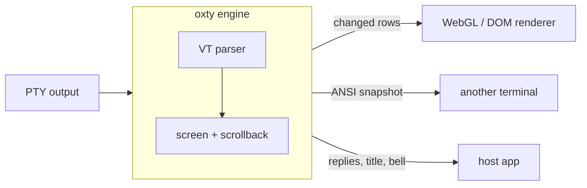

<div align="center">

# oxty — a Rust terminal engine for wasm, Node and native apps

**Diffed cell by cell against xterm.js. Scrollback at about 100 bytes a line.**

Feed it PTY bytes. It keeps the screen and tells your renderer which rows changed.

[](https://github.com/openwong2kim/oxty/actions/workflows/ci.yml)
[](LICENSE-APACHE)


[Measurements](#measurements) · [Quick start](#quick-start) · [The model](#the-model) · [xterm.js parity](#xtermjs-parity) · [Roadmap](#roadmap)

</div>

---

oxty (**ox**ide + **tty**) parses the bytes a program writes to its PTY and
holds everything a terminal knows: characters, colours, cursor, modes and
scrollback. It does not draw anything. Your renderer asks which rows changed
and redraws only those.

The parser and screen model are Alacritty's (`alacritty_terminal` 0.26, built
in and patched to behave like xterm.js). The same engine runs in a native
daemon, in the browser and in an Electron renderer, so the daemon's snapshot
and the screen in your browser cannot disagree about what a byte stream means.



## Highlights

- **One engine, three hosts.** Rust crate, WebAssembly npm package with no
  dependencies, and an N-API binding with the same API.
- **Damage, not frames.** `takeDamage()` returns the rows that changed. When
  output scrolls, it says how far to move the drawn picture first, so only the
  new rows are read.
- **Snapshots that resume.** `ansiSnapshot()` returns bytes that rebuild the
  screen, scrollback, cursor, pen and modes in another terminal, including an
  unfinished escape sequence, so live output can continue right after it.
- **Compressed scrollback.** History older than the newest 16 lines is stored
  as UTF-8 text plus runs of equal attributes: a 120-column log line takes
  about 100 bytes instead of 1440 in xterm.js. Rows decode on read.
- **Built for TUIs.** Synchronized output (`CSI ? 2026 h`), used heavily by
  coding agents, is held until the program ends the update.
- **Checked against xterm.js.** Every fixture is fed to oxty and to
  `@xterm/headless`, and the test fails on any difference that is not listed
  with a reason.

| Where | Package | Notes |
| --- | --- | --- |
| Rust | crate [`oxty`](crates/oxty) | the engine |
| Browser, Electron renderer, Node | npm [`oxty`](packages/oxty) | WebAssembly, no dependencies |
| Node / Electron main, daemons | [`crates/oxty-node`](crates/oxty-node) | N-API binding, same API |

## Measurements

Compared with xterm.js 6.1 betas. Lower is better.

**Browser renderer** — Chrome on an Apple M4, 8 panes of 120×40 with 10,000 lines of
scrollback, 2 MiB of output per pane fed in chunks per frame; oxty drawn with
the WebGL spike in [`spike/d3-webgl`](spike/d3-webgl), xterm.js with its WebGL
addon. Both must end on the same screen hash.

| Workload | oxty renderer RSS | xterm.js renderer RSS |
| --- | ---: | ---: |
| Log, 32 KiB chunks | 192 MiB | 350 MiB |
| Log, 256 KiB chunks | 191 MiB | 356 MiB |
| TUI (synchronized redraws) | 172 MiB | 183 MiB |

**Buffer memory** — Node, 8 terminals of 120×40 with 10,000 lines of
scrollback, oxty (wasm) against `@xterm/headless`.

| Output | oxty | xterm.js |
| --- | ---: | ---: |
| Log lines | 24 MiB | 143 MiB |
| Hangul lines | 32 MiB | 143 MiB |
| A different colour in every cell | 24 MiB | 24 MiB |

**Compressed history outside the engine** — with
[`TermHistory`](#compressed-history-for-your-own-term), replaying an 8 MB
output ring into 100,000 lines of scrollback peaked at 11 MiB, against 143 MiB
for xterm.js headless (wmux daemon experiment, local).

**The cost.** Compressing history makes wasm parsing slower than xterm.js on
some output: 120 ms against 104 ms for log lines, 89 ms against 67 ms for
Hangul lines. In the browser benchmark, CPU time including rendering was
still lower than xterm.js's.

Reproduce the browser numbers with `node bench/run.mjs out.json` in
`spike/d3-webgl` (see its [README](spike/d3-webgl/README.md#렌더러-벤치)).

## Quick start

### JavaScript

```js
import { init, Terminal, Attr, decodeColor } from 'oxty';

await init();                                   // loads oxty.wasm once
const term = new Terminal({ cols: 80, rows: 24, scrollback: 5000, onSyncFlush: draw });

pty.onData((data) => {                          // string or Uint8Array
  term.write(data);
  const replies = term.takeReplies();           // e.g. cursor position reports
  if (replies.length) pty.write(replies);
  draw();
});

function draw() {
  const { full, scroll, lines } = term.takeDamage();
  if (scroll) moveDrawnRowsUp(scroll);          // output scrolled; only new rows follow
  for (const y of full ? [...Array(term.rows).keys()] : lines) {
    const cells = term.rowCells(y);             // [codepoint, fg, bg, attrs] per cell
    for (let x = 0; x < term.cols; x++) {
      const [cp, fg, bg, attrs] = cells.subarray(x * 4, x * 4 + 4);
      if (attrs & Attr.WIDE_SPACER) continue;   // right half of a wide char
      paint(x, y, String.fromCodePoint(cp), decodeColor(fg), decodeColor(bg), attrs);
    }
  }
}
```

### Rust

```rust
let mut term = oxty::Engine::new(80, 24, 5000);
term.feed("안녕 \x1b[1;31mworld\x1b[0m\r\n".as_bytes());
assert_eq!(term.row_text(0).as_deref(), Some("안녕 world"));

match term.take_damage() {
    oxty::Damage::Full => { /* redraw all rows */ }
    oxty::Damage::Lines { scroll, lines } => { /* move up `scroll` rows, redraw `lines` */ }
}
```

### Compressed history for your own `Term`

If you drive the built-in Alacritty `Term` yourself instead of `oxty::Engine`,
`TermHistory` gives it the same compressed scrollback:

```rust
use oxty::TermHistory;
use oxty::vt::event::VoidListener;
use oxty::vt::term::{test::TermSize, Config, Term};
use oxty::vt::vte::ansi::{Processor, StdSyncHandler};

let config = Config { scrolling_history: TermHistory::RECENT, ..Config::default() };
let mut term = Term::new(config, &TermSize::new(120, 40), VoidListener);
let history = TermHistory::attach(&mut term, 100_000); // 100,000 lines in all

Processor::<StdSyncHandler>::new().advance(&mut term, &output);
let oldest = history.row(0);                        // rows 0..history.len(), oldest first
history.resize(&mut term, TermSize::new(100, 30)); // reflows the compressed rows too
```

The grid keeps the newest `TermHistory::RECENT` (16) history rows; older ones
live in `history`, above the grid's own history.

### Installing

oxty is not on crates.io or npm yet. Until then, depend on it from git:

```toml
oxty = { git = "https://github.com/openwong2kim/oxty", rev = "<commit>" }
```

## The model

<details open>
<summary><b>Rows and scrollback</b></summary>

Visible rows are `0..rows`. Scrollback is addressed with negative numbers: `-1`
is the newest history line, `-historyLength` the oldest. A renderer can keep
only what is on screen and fetch history on demand. `scrollDisplay(delta)` /
`scrollToBottom()` move the view; viewport row `y` then shows line
`y - displayOffset`. History rows are kept compressed and decoded when read, so
read only the rows you draw.

</details>

<details open>
<summary><b>Cells</b></summary>

Four `u32` words: Unicode scalar, foreground, background, attributes. Colours
carry their kind in the top byte (named, 256-palette, RGB) so themes stay in
the renderer. Wide characters occupy a `WIDE` cell and a `WIDE_SPACER` cell.
Cells flagged `COMBINING`, `UNDERLINE_COLOR` (SGR 58) or `HYPERLINK` (OSC 8)
have the rest in `rowExtras(y)`, one call per row.

</details>

<details open>
<summary><b>Cursor and damage</b></summary>

`cursor()` gives position, visibility and the DECSCUSR shape (`block`,
`underline`, `bar`) with blinking.

`takeDamage()` returns the viewport rows changed since the last call. When
output scrolled the whole screen, `scroll` says how many rows to move the drawn
picture up first. It is `full` after a resize, a view scroll, a scroll region
change or a screen switch.

</details>

<details>
<summary><b>Things for the host to act on</b></summary>

`takeReplies()` (bytes to send back to the program), `takeTitle()`,
`takeBells()`, `modes()` (cursor visibility, bracketed paste, mouse reporting,
alternate screen, …).

</details>

<details>
<summary><b>Synchronized output</b></summary>

`CSI ? 2026 h` is honoured: output is held until the program ends the update.
The engine has no clock — vte's default timer calls `Instant::now()`, which
traps on `wasm32-unknown-unknown` — so the host flushes stalled updates. The
npm wrapper does this for you after 150 ms and calls `onSyncFlush`; Rust and
N-API hosts call `flush_sync()` themselves.

</details>

<details>
<summary><b>Snapshots</b></summary>

`ansiSnapshot()` returns `{ ok: true, payload }`: bytes that rebuild the
screen, scrollback, cursor, pen and modes in another terminal, including any
unfinished escape or UTF-8 tail. It returns `{ ok: false, reason }`
(`unsupported-wide-edge`, `margins`, `partial-tail-overflow`) when ANSI cannot
express the state; replay the raw bytes instead.

During a synchronized update the payload is the screen from before it,
followed by `CSI ? 2026 h` and the held output raw, so the receiver is inside
the same update. Taking a snapshot never changes the engine, so it is safe on
the terminal a renderer is drawing.

Not carried over yet: charset designation and shift, the DECSC saved cursor,
custom tab stops, cursor shape and OSC 8 links.

</details>

## xterm.js parity

```sh
cd packages/oxty && npm ci && npm test
```

This feeds [wmux](https://github.com/openwong2kim/wmux)'s 91 fixtures to oxty
and to `@xterm/headless`, compares the screens cell by cell, and also restores
each oxty snapshot into xterm.js and compares again. It fails on any
difference not listed, with a reason, in
[`known-differences.json`](packages/oxty/test/xterm/known-differences.json).
`OXTY_SWAP_GATE=1` also fails while an entry is marked `blocksSwap`.

## Building

```sh
cargo test -p oxty                     # engine tests
bash scripts/build-wasm.sh             # → packages/oxty/dist/oxty.wasm
(cd packages/oxty && npm test)         # wasm package tests
bash scripts/build-node.sh             # → crates/oxty-node/oxty.node
node --test crates/oxty-node/test.cjs  # N-API tests
```

Requires Rust ≥ 1.85 and Node ≥ 18. Format with
`cargo fmt -p oxty -p oxty-wasm -p oxty-node`. The built-in Alacritty fork
(`crates/oxty/src/vt`) is `#[rustfmt::skip]` so it stays close to upstream.

## Roadmap

- [x] **Engine core** — rows, cells, cursor, damage with scroll, replies,
      synchronized output, ANSI snapshots, wasm and N-API bindings.
- [x] **Differential tests against xterm.js** — 91 fixtures, two proofs.
- [ ] **Publish to crates.io and npm.** The patched Alacritty fork is built
      into the `oxty` crate as `oxty::vt`, so `oxty` publishes as a single crate.
- [ ] **xterm.js-compatible facade** — `new Terminal(options)`, `open(element)`,
      `onData`, `write`, `buffer` over the oxty engine, keeping xterm.js's
      WebGL/DOM renderers and addons.
- [ ] **Input in Rust** — keyboard (including the kitty protocol), mouse and
      paste encoding shared by every host.
- [ ] **Selection, search and link detection in Rust.**
- [ ] **Host policy hooks** — OSC 52 clipboard, colour queries, hyperlinks.
- [ ] **Prebuilt N-API binaries** for Windows, macOS and Linux.
- [ ] **Fuzzing.**

## Credits

The parser and screen model are
[`alacritty_terminal`](https://github.com/alacritty/alacritty) 0.26, built in
as `oxty::vt` with small compatibility patches (xterm Unicode 11 widths, resize
behaviour, blink, and no PTY/event loop so it builds for wasm32) described in
[`crates/oxty/src/vt/PATCHES.md`](crates/oxty/src/vt/PATCHES.md).
oxty grew out of the terminal engine in [wmux](https://github.com/openwong2kim/wmux).
See [NOTICE.md](NOTICE.md).

## License

Licensed under the [Apache License 2.0](LICENSE-APACHE). Third-party code it
includes keeps its own license; see [NOTICE.md](NOTICE.md).
