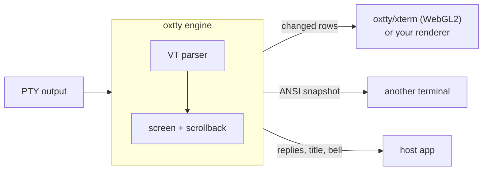

<div align="center">

# oxtty — a Rust terminal engine for wasm, Node and native apps

**Diffed cell by cell against xterm.js. Scrollback at about 100 bytes a line.**

Feed it PTY bytes. It keeps the screen and tells your renderer which rows changed.
Or use `oxtty/xterm`, the xterm.js API with a WebGL2 renderer, also in Rust.

[](https://github.com/openwong2kim/oxtty/actions/workflows/ci.yml)
[](LICENSE-APACHE)


[Measurements](#measurements) · [Quick start](#quick-start) · [xterm.js API](#oxttyxterm-the-xtermjs-api) · [The model](#the-model) · [xterm.js parity](#xtermjs-parity) · [Roadmap](#roadmap)

</div>

---

oxtty (**ox**ide + **tty**) parses the bytes a program writes to its PTY and
holds everything a terminal knows: characters, colours, cursor, modes and
scrollback. The engine does not draw anything. Your renderer asks which rows
changed and redraws only those.

For the browser there is [`oxtty/xterm`](#oxttyxterm-the-xtermjs-api): the
xterm.js `Terminal` API over the same engine, with its renderer, input,
selection, links, search and images written in Rust and compiled to a second
WebAssembly module. Its first goal is memory with many terminals open: with 17
panes of 10,000 lines of scrollback, the browser's renderer process grows by
less than a third of what it grows by with xterm.js
([measurements](#measurements)).

The parser and screen model are Alacritty's (`alacritty_terminal` 0.26, built
in and patched to behave like xterm.js). The same engine runs in a native
daemon, in the browser and in an Electron renderer, so the daemon's snapshot
and the screen in your browser cannot disagree about what a byte stream means.



## Highlights

- **One engine, three hosts.** Rust crate, WebAssembly npm package with no
  dependencies, and an N-API binding with the same API.
- **Damage, not frames.** `takeDamage()` returns the rows that changed. When
  output scrolls, it says how far to move the drawn picture first, so only the
  new rows are read.
- **Snapshots that resume.** `ansiSnapshot()` returns bytes that rebuild the
  screen, scrollback, cursor, pen and modes in another terminal, including an
  unfinished escape sequence, so live output can continue right after it.
- **Compressed scrollback.** History older than the newest 16 lines is stored
  as UTF-8 text plus runs of equal attributes: a 120-column log line takes
  about 100 bytes instead of 1440 in xterm.js. Rows decode on read.
- **Built for TUIs.** Synchronized output (`CSI ? 2026 h`), used heavily by
  coding agents, holds frames until the program ends the update.
- **xterm.js API in the browser.** `oxtty/xterm` mirrors the xterm.js 6.x
  `Terminal`, with fit, search, web links, WebGL and images built in. All
  panes on a page share one WebGL2 context and one glyph atlas, so a 17th pane
  does not run into Chrome's limit of 16 contexts.
- **Checked against xterm.js.** Every fixture is fed to oxtty and to
  `@xterm/headless`, and the test fails on any difference that is not listed
  with a reason.

| Where | Package | Notes |
| --- | --- | --- |
| Rust | crate [`oxtty`](crates/oxtty) | the engine |
| Browser, Electron renderer, Node | npm [`oxtty`](packages/oxtty) | WebAssembly engine, no dependencies |
| Browser, Electron renderer | npm [`oxtty/xterm`](#oxttyxterm-the-xtermjs-api) | xterm.js API, WebGL2 renderer, second WebAssembly module |
| Node / Electron main, daemons | [`crates/oxtty-node`](crates/oxtty-node) | N-API binding, same API |

## Measurements

Compared with xterm.js 6.1 betas. Lower is better.

**Many terminals in a browser** — 17 panes of 120×40, each with 10,000 lines
of scrollback filled, `oxtty/xterm` against `@xterm/xterm` with
`@xterm/addon-webgl`, in headless system Chrome on the real GPU. Memory the
renderer and GPU processes gained over an empty page, and the JS heap after a
GC. Apple M4, macOS, 2026-11-01/02.
`npm run bench:memory` in `packages/oxtty` reproduces it
([bench/memory](packages/oxtty/bench/memory)).

| | oxtty/xterm | xterm.js |
| --- | ---: | ---: |
| Renderer process | +119 MB | +413 MB |
| GPU process | +11 MB | +38 MB |
| JS heap | 3 MB | 41 MB |

RSS moves between runs, the GPU process the most: another run on 2026-11-02
gave +123 against +413 MB for the renderer and +21 against +48 MB for the GPU
process.

**In wmux** — wmux (Electron) with 17 panes and 10,000 lines of scrollback,
the xterm.js renderer against oxtty, three alternating runs, macOS footprint
figures. Apple M4, 2026-11-01/02.

| | xterm.js | oxtty | |
| --- | ---: | ---: | ---: |
| Renderer process footprint | 297 MB | 139 MB | −53% |
| App footprint | 695 MB | 546 MB | −21% |
| JS heap | 82.5 MB | 21.0 MB | |
| WebAssembly memory | 7.9 MB | 54.0 MB | |
| GPU process footprint | 259 MB | 276 MB | +17 MB, not yet attributed |

The cells and scrollback move from the JS heap into WebAssembly memory, where
they take less room.

**Engine memory for 17 terminals** — each parser used to reserve 2 MiB to
hold synchronized updates. Since the engine applies them at once, as xterm.js
does, 17 terminals take 5.1 MiB of engine memory instead of 41.1 MiB
(2026-11-02).

**Download size** — built 2026-11-02, gzip −9.

| Module | Bytes | gzip | Budget |
| --- | ---: | ---: | --- |
| Engine `oxtty.wasm` | 307,707 | 111,732 | 340 KiB |
| Front end `xterm_web_bg.wasm` (`oxtty/xterm` only) | 727,245 | 274,609 | 800 KiB raw, 300 KiB gzip |

One instance of each serves every terminal on a page, so the code is paid
once, not per pane. `scripts/build-web.sh` and `test/web/size.test.mjs` fail
over budget.

**Buffer memory** — Node, 8 terminals of 120×40 with 10,000 lines of
scrollback, oxtty (wasm) against `@xterm/headless`.

| Output | oxtty | xterm.js |
| --- | ---: | ---: |
| Log lines | 24 MiB | 143 MiB |
| Hangul lines | 32 MiB | 143 MiB |
| A different colour in every cell | 24 MiB | 24 MiB |

**Parser throughput** — MiB/s, higher is better. Node 22 on an Apple M4,
120×40 with 10,000 lines of scrollback, 8 MiB of generated output per row fed
in 64 KiB chunks, median of 5 runs. All three end on the same screen.
`node --expose-gc packages/oxtty/bench/throughput.mjs` reproduces it after
building the wasm and N-API modules.

| Output | oxtty native | oxtty wasm | xterm.js headless |
| --- | ---: | ---: | ---: |
| Log lines, some colour | 116 | 72 | 98 |
| Truecolor fg and bg in every cell | 252 | 142 | 143 |
| Hangul, CJK and emoji | 102 | 73 | 100 |
| Cursor jumps (TUI redraw) | 194 | 128 | 113 |
| Scrolling region (DECSTBM) | 164 | 112 | 41 |
| Short lines into scrollback | 103 | 59 | 60 |

**Compressed history outside the engine** — with
[`TermHistory`](#compressed-history-for-your-own-term), replaying an 8 MB
output ring into 100,000 lines of scrollback peaked at 11 MiB, against 143 MiB
for xterm.js headless (wmux daemon experiment, local).

**The cost.** Compressing history makes wasm parsing slower than xterm.js on
some output: 120 ms against 104 ms for log lines, 89 ms against 67 ms for
Hangul lines.

## Quick start

### Browser terminal with the xterm.js API

```js
import { init, Terminal, FitAddon } from 'oxtty/xterm';

await init();                                   // loads both wasm modules, once per page
const term = new Terminal({ fontFamily: 'Menlo, monospace', fontSize: 14, scrollback: 10000 });
const fit = new FitAddon();
term.loadAddon(fit);
term.open(document.getElementById('terminal'));
fit.fit();

pty.onData((data) => term.write(data));         // string or Uint8Array
term.onData((data) => pty.write(data));         // keys, paste, mouse reports, replies
```

See [`oxtty/xterm`](#oxttyxterm-the-xtermjs-api) for what is supported.

### JavaScript engine, your own renderer

```js
import { init, Terminal, Attr, decodeColor } from 'oxtty';

await init();                                   // loads oxtty.wasm once
const term = new Terminal({ cols: 80, rows: 24, scrollback: 5000, onSyncFlush: draw });

pty.onData((data) => {                          // string or Uint8Array
  term.write(data);
  const replies = term.takeReplies();           // e.g. cursor position reports
  if (replies.length) pty.write(replies);
  draw();
});

function draw() {
  const { full, scroll, lines } = term.takeDamage();
  if (scroll) moveDrawnRowsUp(scroll);          // output scrolled; only new rows follow
  for (const y of full ? [...Array(term.rows).keys()] : lines) {
    const cells = term.rowCells(y);             // [codepoint, fg, bg, attrs] per cell
    for (let x = 0; x < term.cols; x++) {
      const [cp, fg, bg, attrs] = cells.subarray(x * 4, x * 4 + 4);
      if (attrs & Attr.WIDE_SPACER) continue;   // right half of a wide char
      paint(x, y, String.fromCodePoint(cp), decodeColor(fg), decodeColor(bg), attrs);
    }
  }
}
```

### Rust

```rust
let mut term = oxtty::Engine::new(80, 24, 5000);
term.feed("안녕 \x1b[1;31mworld\x1b[0m\r\n".as_bytes());
assert_eq!(term.row_text(0).as_deref(), Some("안녕 world"));

match term.take_damage() {
    oxtty::Damage::Full => { /* redraw all rows */ }
    oxtty::Damage::Lines { scroll, lines } => { /* move up `scroll` rows, redraw `lines` */ }
}
```

### Compressed history for your own `Term`

If you drive the built-in Alacritty `Term` yourself instead of `oxtty::Engine`,
`TermHistory` gives it the same compressed scrollback:

```rust
use oxtty::TermHistory;
use oxtty::vt::event::VoidListener;
use oxtty::vt::term::{test::TermSize, Config, Term};
use oxtty::vt::vte::ansi::{Processor, StdSyncHandler};

let config = Config { scrolling_history: TermHistory::RECENT, ..Config::default() };
let mut term = Term::new(config, &TermSize::new(120, 40), VoidListener);
let history = TermHistory::attach(&mut term, 100_000); // 100,000 lines in all

Processor::<StdSyncHandler>::new().advance(&mut term, &output);
let oldest = history.row(0);                        // rows 0..history.len(), oldest first
history.resize(&mut term, TermSize::new(100, 30)); // reflows the compressed rows too
```

The grid keeps the newest `TermHistory::RECENT` (16) history rows; older ones
live in `history`, above the grid's own history.

### Installing

oxtty is not on crates.io or npm yet. Until then, depend on it from git:

```toml
oxtty = { git = "https://github.com/openwong2kim/oxtty", rev = "<commit>" }
```

## oxtty/xterm: the xterm.js API

`oxtty/xterm` is a `Terminal` with the xterm.js 6.x API, written in Rust
([`crates/oxtty-web`](crates/oxtty-web)) and compiled to its own WebAssembly
module, `xterm_web_bg.wasm`. It talks to the engine module through the same
`oxtty` package, so an engine crash rebuilds one terminal and the page keeps
running. The renderer, keyboard, IME, mouse, selection, links, search, images,
accessibility tree and scrollbar are Rust ports of the xterm.js code; each
file names the xterm.js source lines it follows (see [NOTICE.md](NOTICE.md)).

### Migrating from xterm.js

```diff
-import { Terminal } from '@xterm/xterm';
-import { FitAddon } from '@xterm/addon-fit';
-import { WebglAddon } from '@xterm/addon-webgl';
-import '@xterm/xterm/css/xterm.css';
+import { init, Terminal, FitAddon, WebglAddon } from 'oxtty/xterm';
+
+await init();
```

- **`await init()` once per page**, before the first `new Terminal()` (which
  throws until then). It loads `oxtty.wasm` and `xterm_web_bg.wasm` from next
  to the module; `init(engine, frontEnd)` takes other sources (a URL, a
  `Response` or the bytes), e.g. an Electron page on `file://` passes the
  bytes it got over IPC.
- **The addons are built in.** Import `FitAddon`, `SearchAddon`,
  `WebLinksAddon`, `ImageAddon` and `WebglAddon` from `oxtty/xterm` and drop
  the `@xterm/addon-*` packages.
- **`loadAddon` absorbs** `@xterm/addon-webgl`, `@xterm/addon-unicode11` and
  `@xterm/addon-image` objects: their work is built in (an image addon's
  options are read), so existing code keeps working. `@xterm/addon-search`
  and `@xterm/addon-serialize` throw with the replacement in the message (the
  built-in `SearchAddon`, `term.ansiSnapshot()`); any other addon throws,
  `@xterm/addon-fit` and `@xterm/addon-web-links` included.
- **Drop the `xterm.css` import.** `open()` injects its own styles.
- **No `_core`.** `term.dimensions`, `onDimensionsChange`,
  `term.kittyKeyboardFlags`, `term.resetKittyKeyboard()` and `term.onUserInput`
  replace the private members apps reach for.
- The published `.d.ts` declares only what is supported, so the compiler
  points at anything else.

### API support

[`api-checklist.json`](packages/oxtty/test/web/api-checklist.json) is the
source of truth: every xterm.js member [wmux](https://github.com/openwong2kim/wmux)
uses (`@xterm/xterm` 6.1.0-beta.336 and its addons), with a status and a
reason. A test fails if a `supported` member is missing from the `.d.ts` or no
test exercises it. Today: **104 supported, 11 not planned, none left for
later.** xterm.js members outside the checklist are not provided.

✅ supported · ⏳ later · — not planned (the replacement is named)

**Terminal**

| Member | Status | Notes |
| --- | :---: | --- |
| `new Terminal(options)`, `init()` | ✅ | `cols`, `rows`, `scrollback` are fixed at construction, as in xterm.js |
| Options `cursorBlink`, `cursorStyle`, `fontSize`, `fontFamily`, `theme`, `minimumContrastRatio`, `scrollbar` | ✅ | Runtime changes re-measure the cell, rebuild the atlas and fire `onDimensionsChange` as needed |
| Options `scrollOnUserInput`, `disableStdin`, `altClickMovesCursor`, `macOptionClickForcesSelection`, `linkHandler`, `screenReaderMode`, `windowsPty`, `windowOptions`, `vtExtensions.kittyKeyboard`, `allowProposedApi` | ✅ | `allowProposedApi` is read back and has no effect |
| Options `convertEol`, `vtExtensions.colorSchemeQuery`, `vtExtensions.kittySgrBoldFaintControl` | — | Always off |
| `open`, `write`, `writeln`, `resize`, `reset`, `refresh`, `dispose`, `focus`, `input` | ✅ | Writes are parsed in 12 ms slices like the xterm.js write buffer; `open()` again moves the element |
| `scrollToLine`, `scrollToBottom`, `scrollToTop`, `scrollPages` | ✅ | |
| `getSelection`, `hasSelection`, `clearSelection`, `select` | ✅ | Ported `SelectionService`: word, line and column selection, same copied text as xterm.js |
| `attachCustomKeyEventHandler`, `textarea` | ✅ | Keyboard and IME handling ported from xterm.js 6.1 |
| `registerLinkProvider`, OSC 8 links | ✅ | Ported `Linkifier` and `OscLinkProvider` |
| `registerMarker`, `markers`, `IMarker` | ✅ | Not on the alternate screen (see below) |
| `element`, `rows`, `cols`, `dimensions`, `modes`, `unicode.activeVersion` | ✅ | `unicode.activeVersion` is always `"11"` |
| `onData`, `onBinary`, `onResize`, `onScroll`, `onRender`, `onCursorMove`, `onWriteParsed`, `onTitleChange`, `onBell`, `onDimensionsChange`, `onSelectionChange` | ✅ | |
| `ansiSnapshot()`, `kittyKeyboardFlags`, `resetKittyKeyboard()`, `onUserInput` | ✅ | oxtty additions that replace `@xterm/addon-serialize` and `_core` workarounds |
| DOM: `.terminal.xterm`, `.xterm-screen`, `.xterm-helpers`, `.xterm-helper-textarea`, `.composition-view`, `.xterm-scrollable-element` scrollbar | ✅ | The class names xterm.js 6.1 uses |
| `@xterm/xterm/css/xterm.css` | — | `open()` injects its own styles |
| `_core._renderService`, `_core._charSizeService`, `_core._compositionHelper`, `WebglAddon._renderer` | — | No internals: use `dimensions` and `onDimensionsChange`; context loss and the atlas are handled inside the renderer |

**Buffer**

| Member | Status | Notes |
| --- | :---: | --- |
| `buffer.active`, `buffer.normal`, `buffer.alternate`, `buffer.onBufferChange` | ✅ | A new object per read |
| `type`, `baseY`, `viewportY`, `cursorX`, `cursorY`, `length`, `getLine`, `getNullCell` | ✅ | `getLine` returns a copy of the row at call time (xterm.js: a live view) |
| `IBufferLine`: `translateToString`, `isWrapped`, `length`, `getCell` | ✅ | Typed spaces are text and erased cells are trimmed, as in xterm.js |
| `IBufferCell`: `getChars`, `getCode`, `getWidth`, `isBold`, `isDim`, `isItalic`, `isUnderline`, `isBlink`, `isInverse`, `isInvisible`, `isStrikethrough` | ✅ | |

**Parser**

| Member | Status | Notes |
| --- | :---: | --- |
| `parser.registerCsiHandler`, `registerOscHandler`, `registerDcsHandler` | ✅ | On the engine's parser hooks: newest first, `true` skips the default, a returned `Promise` holds the write queue |
| `write()` from inside a handler | ✅ | Queued behind the data being parsed, as in xterm.js |

**Addons**

| Addon | Status | Notes |
| --- | :---: | --- |
| Fit (`fit`, `proposeDimensions`, subclasses) | ✅ | Built-in `FitAddon`, ported from `@xterm/addon-fit` 0.12; refits by itself when the cell size changes |
| Search (`findNext`, `findPrevious`, `clearDecorations`, decorations) | ✅ | Built-in `SearchAddon`, ported from `@xterm/addon-search` 0.17; plain text and regular expressions are matched in JS (string methods, `RegExp`), so no matcher is compiled into the wasm |
| WebLinks | ✅ | Built-in `WebLinksAddon`, ported from `@xterm/addon-web-links` 0.13; the same URL pattern or `urlRegex` |
| Webgl (`onContextLoss`, `clearTextureAtlas`, `dispose`) | ✅ | Absorbed: the WebGL2 renderer is always on, one context per page; `onContextLoss` never fires because the renderer restores the context itself |
| Unicode11 | ✅ | Absorbed: the engine's widths are Unicode 11 |
| Image (sixel, iTerm2 OSC 1337, `_handlers`) | ✅ | Built-in `ImageAddon` in Rust, or an absorbed `@xterm/addon-image`; sixel is decoded in Rust, PNG/JPEG/GIF/WebP/AVIF by the browser; tiles live in engine cells and storage is page-wide |
| Serialize | — | `term.ansiSnapshot({ scrollback, excludeModes })` replaces `serialize()`; the tests compare it with the addon |

### Browser support

| | |
| --- | --- |
| WebGL2 | Required to draw. All panes share one WebGL2 context and glyph atlas; a lost context is restored or replaced for every pane at once |
| Without WebGL2 | `open()` works, as in xterm.js, with one console warning: input, the buffer API and events work, but nothing is drawn and `dimensions` stays `undefined` |
| DOM renderer | None, and none planned for now |
| Tested in | Chrome (the browser tests run in headless system Chrome) and Electron (wmux). Other browsers with WebGL2 are expected to work but are not tested yet |

### Known differences from xterm.js

Beyond the notes in the tables above:

- A selection follows lines trimmed off the scrollback and screen switches at
  the next animation frame, not during the write (PRD D7).
- Markers do not exist on the alternate screen: `registerMarker` returns
  `undefined` there and `markers` is `[]`.
- `term.parser`, the buffer objects and `term.markers` return new objects on
  every read.
- An empty CSI sub-parameter is `0` (xterm.js: `-1`).
- The engine does not answer DECRQSS, so a DCS handler that falls through
  sends nothing.
- With `scrollbar.showScrollbar: false` there is no
  `.xterm-scrollable-element` wrapper.
- Without an `ImageAddon` the engine always answers `CSI 18 t` (xterm.js only
  when `windowOptions` allows it).
- `ImageAddon`: no kitty graphics, no QOI images, no
  `getImageAtBufferCell`/`extractTileAtBufferCell`; an image payload over 10 MB
  is dropped (the parser hook limit), where the addon takes up to its 32 MB
  size limits.
- Search decorations have no overview ruler marks.
- The synchronized output timeout (1000 ms) counts from the write that opened
  the update (xterm.js: from the first held frame).
- Character widths are Unicode 11 only.
- `buffer.active.cursorX` stays on the last column at the right edge (xterm.js
  reports `cols` while a wrap is pending).

## The model

<details open>
<summary><b>Rows and scrollback</b></summary>

Visible rows are `0..rows`. Scrollback is addressed with negative numbers: `-1`
is the newest history line, `-historyLength` the oldest. A renderer can keep
only what is on screen and fetch history on demand. `scrollDisplay(delta)` /
`scrollToBottom()` move the view; viewport row `y` then shows line
`y - displayOffset`. History rows are kept compressed and decoded when read, so
read only the rows you draw.

</details>

<details open>
<summary><b>Cells</b></summary>

Four `u32` words: Unicode scalar, foreground, background, attributes. Colours
carry their kind in the top byte (named, 256-palette, RGB) so themes stay in
the renderer. Wide characters occupy a `WIDE` cell and a `WIDE_SPACER` cell.
Cells flagged `COMBINING`, `UNDERLINE_COLOR` (SGR 58) or `HYPERLINK` (OSC 8)
have the rest in `rowExtras(y)`, one call per row.

</details>

<details open>
<summary><b>Cursor and damage</b></summary>

`cursor()` gives position, visibility and the DECSCUSR shape (`block`,
`underline`, `bar`) with blinking.

`takeDamage()` returns the viewport rows changed since the last call. When
output scrolled the whole screen, `scroll` says how many rows to move the drawn
picture up first. It is `full` after a resize, a view scroll, a scroll region
change or a screen switch.

</details>

<details>
<summary><b>Things for the host to act on</b></summary>

`takeReplies()` (bytes to send back to the program; `takeReplyList()` gives
them one reply at a time, as xterm.js fires `onData`), `takeTitle()`,
`takeBells()`, `modes()` (cursor visibility, bracketed paste, mouse reporting,
alternate screen, …).

Clipboard and colour queries are the host's call and off until it opts in.
`setClipboardAccess({ read, write })` lets OSC 52 through:
`takeClipboardWrite()` hands over text to copy, `takeClipboardRead()` a
clipboard to read, answered with `replyClipboard(selection, text)`.
`setColors(colors)` (`COLOR_SLOTS` = 259 values: palette, foreground,
background, cursor) answers OSC 4/10/11/12 queries. Replies are byte for byte
what xterm.js and its clipboard addon send.

</details>

<details>
<summary><b>Synchronized output</b></summary>

`CSI ? 2026 h` is honoured as in xterm.js: the output is applied at once (the
rows read the new content) and `sync_pending()` is true until the program ends
the update, so a renderer holds its frames meanwhile. The engine has no clock
(`Instant::now()` traps on `wasm32-unknown-unknown`), so the host ends stalled
updates. The npm wrapper does this for you after 1000 ms, as xterm.js does,
and calls `onSyncFlush`, and `oxtty/xterm` holds its frames on its own; Rust
and N-API hosts check `sync_pending()` and call `flush_sync()` themselves.

</details>

<details>
<summary><b>Snapshots</b></summary>

`ansiSnapshot()` returns `{ ok: true, payload }`: bytes that rebuild the
screen, scrollback, cursor, pen and modes in another terminal, including any
unfinished escape or UTF-8 tail. It returns `{ ok: false, reason }`
(`unsupported-wide-edge`, `margins`, `partial-tail-overflow`) when ANSI cannot
express the state; replay the raw bytes instead.

During a synchronized update `CSI ? 2026 h` comes before the unfinished tail,
so the receiver is inside the same update. Taking a snapshot never changes the engine, so it is safe on
the terminal a renderer is drawing.

Not carried over yet: charset designation and shift, the DECSC saved cursor,
custom tab stops and cursor shape.

</details>

## xterm.js parity

```sh
cd packages/oxtty && npm ci && npm test
```

This feeds [wmux](https://github.com/openwong2kim/wmux)'s 91 fixtures to oxtty
and to `@xterm/headless`, compares the screens cell by cell, and also restores
each oxtty snapshot into xterm.js and compares again. It fails on any
difference not listed, with a reason, in
[`known-differences.json`](packages/oxtty/test/xterm/known-differences.json).
`OXTTY_SWAP_GATE=1` also fails while an entry is marked `blocksSwap`; none
is today.

```sh
cd packages/oxtty && npm run test:web
```

runs `oxtty/xterm` and xterm.js side by side in headless system Chrome
(SwiftShader WebGL2) and compares what they do with the same input: `onData`
bytes for keys, IME, paste and mouse, selections and copied text, links,
search matches, image cells and pixels, events and the DOM.

## Building

```sh
cargo test -p oxtty                     # engine tests
bash scripts/build-wasm.sh             # → packages/oxtty/dist/oxtty.wasm
bash scripts/build-web.sh              # → packages/oxtty/dist/xterm_web_bg.wasm (oxtty/xterm)
(cd packages/oxtty && npm test)         # wasm package tests
(cd packages/oxtty && npm run test:web) # oxtty/xterm in Chrome
bash scripts/build-node.sh             # → crates/oxtty-node/oxtty.node
node --test crates/oxtty-node/test.cjs  # N-API tests
```

Requires Rust ≥ 1.85 and Node ≥ 18; `build-web.sh` also needs the
`wasm-bindgen` CLI at the version `crates/oxtty-web` pins, and `test:web` a
system Chrome. Format with
`cargo fmt -p oxtty -p oxtty-wasm -p oxtty-node -p oxtty-web`. The built-in Alacritty fork
(`crates/oxtty/src/vt`) is `#[rustfmt::skip]` so it stays close to upstream.

## Roadmap

- [x] **Engine core** — rows, cells, cursor, damage with scroll, replies,
      synchronized output, ANSI snapshots, wasm and N-API bindings.
- [x] **Differential tests against xterm.js** — 91 fixtures, two proofs.
- [ ] **Publish to crates.io and npm.** The patched Alacritty fork is built
      into the `oxtty` crate as `oxtty::vt`, so `oxtty` publishes as a single crate.
- [x] **`oxtty/xterm`, the xterm.js API in Rust** — WebGL2 renderer with one
      context per page, built-in fit, search, web links and images; 104 of
      the 115 members on the [API checklist](#api-support) supported.
- [x] **Input in Rust** — keyboard (including the kitty protocol), mouse,
      paste and focus encoding in the engine crate, ported from xterm.js.
- [x] **Selection, search and link detection in Rust** — in `oxtty/xterm`.
- [ ] **Adopted in wmux** — the 17-pane trial is [measured](#measurements);
      the renderer swap is next.
- [x] **Host policy hooks** — OSC 52 clipboard and OSC 4/10/11/12 colour
      queries, off until the host opts in.
- [ ] **Prebuilt N-API binaries** for Windows, macOS and Linux.
- [ ] **Fuzzing.** Seeded random streams run with every `cargo test`;
      continuous fuzzing is not set up yet.

## Credits

The parser and screen model are
[`alacritty_terminal`](https://github.com/alacritty/alacritty) 0.26, built in
as `oxtty::vt` with small compatibility patches (xterm Unicode 11 widths, resize
behaviour, blink, and no PTY/event loop so it builds for wasm32) described in
[`crates/oxtty/src/vt/PATCHES.md`](crates/oxtty/src/vt/PATCHES.md).
The input encoders and `oxtty/xterm` (renderer, fit, input, selection, links,
search, images, accessibility, scrollbar) are Rust ports of
[xterm.js](https://github.com/xtermjs/xterm.js) and its addons (MIT), and the
sixel decoder of [node-sixel](https://github.com/jerch/node-sixel) (MIT); each
file names its source lines.
oxtty grew out of the terminal engine in [wmux](https://github.com/openwong2kim/wmux).
See [NOTICE.md](NOTICE.md).

## License

Licensed under the [Apache License 2.0](LICENSE-APACHE). Third-party code it
includes keeps its own license; see [NOTICE.md](NOTICE.md).
