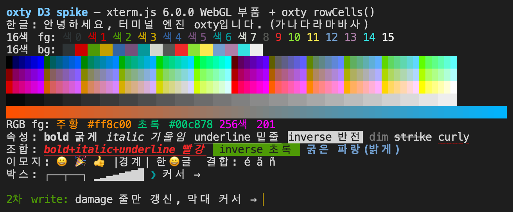

# D3 validation spike: drawing oxtty rows with xterm.js WebGL parts

This spike decides whether PRD §5 D3 ("a thin in-house front end + borrowed xterm.js parts") actually works. It detaches the parts of the xterm.js WebGL renderer (glyph texture atlas, glyph and rectangle renderers, render model, cell color resolver) and draws a screen on a canvas from the `rowCells(y)` output of the oxtty wasm engine.

## Verdict: **D3 confirmed**

- 22 renderer part files (4,646 lines) were copied, and **19 of them were not changed by a single character**. The other 3 are excerpts of type declaration files, cutting out only the needed interfaces verbatim. None of the copied code's logic was changed.
- 5 internal services came along, each with 1–2 members actually used. The stubs total 112 lines, of which the service interface stubs are 35 lines.
- **Nothing came along** from the buffer side (`IBufferService`, `BufferLine`, `CellData`, `ICoreService`) or the render service side (`IRenderService`, `ICharSizeService`, `ICharacterJoinerService`, `ILinkifier2`). The boundary cuts cleanly at "the render model (`Uint32Array`, 4 words per cell)".
- So with just a 179-line orchestrator replacing xterm.js `WebglRenderer.ts` (679 lines) and a 108-line cell converter, it drew Hangul, 16/256/RGB colors, attributes, wide emoji, combining characters, box characters and the cursor. The path that reads damage and redraws only the changed lines was also confirmed.

## Running

```sh
cd spike/d3-webgl
npm install
npm run build        # tsc --noEmit → esbuild bundle → dist/ (runs scripts/build-wasm.sh if oxtty.wasm is missing)
npm run screenshot   # local server + system Chrome (headless) → screenshot.png, exit 1 on any console error
```



Visual check results:
- Hangul is drawn to fit 2 cells, and 16-color foreground and background, 256 colors (cube, grayscale), the RGB background gradient, and RGB and 256-color foregrounds are all correct.
- bold, italic, underline (including the 2-cell width of Hangul), inverse, dim, strike and curly underline are correct. bold+blue is drawn as bright blue per `drawBoldTextInBrightColors`.
- 😀🎉👍 are drawn in 2 cells without breaking the boundaries with neighboring cells. Combining characters (é ä ñ) and box and block characters (CustomGlyphs) are also correct.
- The cursor is drawn as a block. After the 2nd write it moved to the last line, and the previous cursor cell was cleared.
- Expected difference: the curly underline is set to red (SGR 58) but drawn in the foreground color. This is because the oxtty cell format has no underline color (item 1 in "What the engine API lacked" below).

## Renderer bench

The same bytes are split across rAF frames into N panels of xterm.js 6.1 (WebGL addon) and of oxtty (this renderer + `src/WriteQueue.ts`). Each sample launches a fresh Chrome and measures main thread CPU (CDP `TaskDuration`), frame intervals, and renderer and GPU process RSS. The screen hashes of both sides must match.

```sh
cd spike/d3-webgl/bench && npm install && cd ..
node bench/run.mjs out.json            # log·tui × 8 panels, 3 repetitions (--quick, --align)
node bench/summ.mjs out.json           # median summary
node bench/check.mjs                   # checks that incremental rendering and a from-scratch render give identical pixels
```

`--align` cuts TUI output only at synchronized block (`?2026`) boundaries. If it cuts in the middle of a block as in the default setting, xterm.js is mid-sync on every rAF and barely draws until the end.

## xterm.js provenance

- Repository: https://github.com/xtermjs/xterm.js
- Tag `6.0.0`, commit `f447274f430fd22513f6adbf9862d19524471c04`
- License: MIT, copy in [`vendor-xterm/LICENSE`](vendor-xterm/LICENSE)
- The top 2 lines of each file record the source path, the commit, and whether it is "verbatim" or an "excerpt". The directory layout follows the original paths.

## Copied files (22, 4,646 lines, excluding the 2-line header comments)

| File | Lines | Status | Role |
|---|---:|---|---|
| `addons/addon-webgl/src/TextureAtlas.ts` | 1138 | verbatim | Glyph rasterization, atlas page management |
| `addons/addon-webgl/src/CustomGlyphs.ts` | 693 | verbatim | Drawing box, block and powerline characters directly |
| `addons/addon-webgl/src/GlyphRenderer.ts` | 390 | verbatim | Glyph instance shader |
| `addons/addon-webgl/src/RectangleRenderer.ts` | 382 | verbatim | Background and cursor rectangle shader |
| `addons/addon-webgl/src/CellColorResolver.ts` | 236 | verbatim | Resolving inverse, selection and decoration colors |
| `addons/addon-webgl/src/Types.ts` | 126 | verbatim | Render model and atlas types |
| `addons/addon-webgl/src/CharAtlasUtils.ts` | 80 | verbatim | Building the atlas config |
| `addons/addon-webgl/src/WebglUtils.ts` | 63 | verbatim | Shader compilation utilities |
| `addons/addon-webgl/src/RenderModel.ts` | 41 | verbatim | Render model (code, bg, fg, ext per cell) |
| `addons/addon-webgl/src/Constants.ts` | 12 | verbatim | |
| `src/common/Color.ts` | 376 | verbatim | Color conversion, contrast |
| `src/common/buffer/AttributeData.ts` | 211 | verbatim | Interpreting fg, bg and ext bits |
| `src/common/TaskQueue.ts` | 166 | verbatim | Idle queue for atlas warm-up |
| `src/common/buffer/Constants.ts` | 157 | verbatim | Attribute bit constants |
| `src/common/Platform.ts` | 44 | verbatim | |
| `src/common/MultiKeyMap.ts` | 42 | verbatim | Glyph cache key |
| `src/browser/renderer/shared/RendererUtils.ts` | 95 | verbatim | |
| `src/browser/renderer/shared/SelectionRenderModel.ts` | 93 | verbatim | Selection range render model |
| `src/browser/ColorContrastCache.ts` | 34 | verbatim | |
| `src/common/Types.ts` | 119 (original 552) | excerpt | `IColor`, `IAttributeData`, `ICellData`, etc. |
| `src/browser/Types.ts` | 95 (original 226) | excerpt | `IColorSet`, `DEFAULT_ANSI_COLORS`, includes an `ITerminal` stub |
| `src/browser/renderer/shared/Types.ts` | 53 (original 84) | excerpt | `IRenderDimensions`, `ISelectionRenderModel` |

Not taken: `WebglRenderer` and `WebglAddon` (replaced by the oxtty orchestrator), `CharAtlasCache` (atlas sharing across terminals), `CursorBlinkStateManager`, `DevicePixelObserver`, `renderLayer/LinkRenderLayer`, `common/buffer/CellData` and `BufferLine`, and all service implementations.

## Stub list (members implemented per interface)

Only the members the copied parts actually call were kept. Interfaces are in `stubs/`, implementations in `src/services.ts`.

| Stub | Original | Members kept | Implementation |
|---|---|---|---|
| `IOptionsService` | `common/services/Services.ts` (396 lines, 22 services) | 1: `rawOptions` (`rescaleOverlappingGlyphs`, `fontSize`) | Constant object |
| `IUnicodeService` | 〃 | 2: `wcwidth`, `getStringCellWidth` | Set lookup filled from the oxtty `WIDE` bit (the Unicode width table is not taken) |
| `IDecorationService` | 〃 | 1: `forEachDecorationAtCell` | Empty function |
| `IThemeService` | `browser/services/Services.ts` (158 lines, 9 services) | 2: `colors`, `onChangeColors` | Color set built from `DEFAULT_ANSI_COLORS` |
| `ICoreBrowserService` | 〃 | 2: `dpr`, `isFocused` | Constants |
| `@xterm/xterm` `Terminal` | `typings/xterm.d.ts` (1957 lines) | 4: `cols`, `rows`, `element`, `buffer.active.viewportY` | Object wrapping the oxtty `Terminal` |
| `@xterm/xterm` `ITerminalOptions` | 〃 | 10 fields (types only) | `terminalOptions` |
| `browser/Types` `ITerminal` | `browser/Types.ts` | 2: `rows`, `buffers.active.ydisp` | Types only. Used only by selection updates (`SelectionRenderModel.update`), which this spike does not call |
| `vs/base/common/lifecycle` | 801 lines (from VS Code) | `Disposable` (`_register`, `dispose`), `toDisposable` | 23 lines |
| `vs/base/common/event` | 1778 lines (from VS Code) | `Emitter` (`event`, `fire`, `dispose`), `Event` type | 22 lines |

`ICharSizeService` was not stubbed. Instead, the renderer measures the character size itself the same way as xterm.js `TextMetricsMeasureStrategy` (10 lines).

## oxtty cell → xterm render model conversion (`src/convert.ts`, `src/OxttyWebglRenderer.ts`)

xterm.js reads cells with `BufferLine.loadCell(x, CellData)`, settles colors with `CellColorResolver.resolve()`, and puts them into the render model (`Uint32Array`, `[code, bg, fg, ext]` per cell). The spike puts `OxttyCellData.load()` in place of `loadCell`, and the rest (`CellColorResolver` → `RenderModel` → `GlyphRenderer.updateCell` → `RectangleRenderer.updateBackgrounds`) runs through the original code unchanged.

- **Colors**: oxtty high-byte kind → xterm `Attributes.CM_*`
  - RGB → `CM_RGB | 0xRRGGBB`
  - INDEXED n → `CM_P16 | n` if n < 16, otherwise `CM_P256 | n`
  - NAMED 0~15 → `CM_P16 | n`, the Dim family (259~266) → `CM_P16 | (n-259)`, 256·257·258·267·268 (default foreground, background, cursor, etc.) → `CM_DEFAULT`
- **Attributes**: BOLD, INVERSE, HIDDEN, STRIKEOUT, BLINK and UNDERLINE → `FgFlags` in `fg`; DIM and ITALIC → `BgFlags` in `bg`. Double, curly, dotted and dashed underlines set `bg |= HAS_EXTENDED` with `UnderlineStyle` in `ext`.
- **Wide characters**: `WIDE` means width 2; `WIDE_SPACER` is left as code 0 and width 0 like xterm.js, keeping its colors (so the background rectangle continues). `WIDE` code points are recorded in the `IUnicodeService` stub so the atlas draws the underline 2 cells wide.
- **Combining characters**: for `COMBINING`, the full string is fetched with `cellText(y, x)` and sent down the xterm.js combined path (`COMBINED_CHAR_BIT_MASK`, `getRasterizedGlyphCombinedChar`). Astral characters (emoji) also take the same path because, as in xterm.js, their JS string length is 2.
- **Cursor**: the block cursor cell's colors are overwritten using `cursor()`'s line, col and visible (the same approach as `WebglRenderer._updateModel`).
- **Updates**: if `takeDamage()` is `full`, the whole model is updated, otherwise only `lines`. Cells whose model already holds the same value are skipped (original logic unchanged).

## What the oxtty engine API lacked

> 1–4 have all been addressed (the commit filling the engine API gaps). Underline color and combining characters come from `rowExtras()`, cursor shape from `cursor().shape/blink`, and the bundle builds without `external`. In the screenshot the curly underline is red and the cursor is a bar. When a scroll shift (`takeDamage().scroll`) arrives, every line is revisited as in xterm.js, but since nothing is cleared, cells equal to the render model are skipped. Glyph vertices contain the cell position, so lines are not moved wholesale.

1. **No underline color (SGR 58)**: there is no room in the 4 cell words, so the curly underline is drawn in the foreground color. The per-row extras table from PRD D2 is needed. On the xterm side it can go straight into the low 26 bits of `ext` (`underlineColor`).
2. **Combining character strings must be fetched cell by cell**: `rowCells` has only the `COMBINING` flag, and the string requires calling `cellText(y, x)` per cell. On lines with many combining characters (Devanagari, composed Hangul jamo, etc.) wasm boundary calls grow with the number of cells. A per-row API (for example a column → string extras table) would help. Putting it into the D2 extras table is recommended.
3. **No cursor shape**: `cursor()` returns only line, col and visible. Drawing DECSCUSR (block, underline, bar, blinking) needs the shape and whether it blinks. For now it is fixed to a block.
4. **Packaging**: because of the `await import('node:fs/promises')` branch in `packages/oxtty/src/index.js`, building a browser bundle with esbuild required `external: ['node:*']`. Other bundlers may warn or error too.

The `WIDE` and `WIDE_SPACER` bits were enough for wide character widths. The xterm.js Unicode width check the atlas used could be replaced with the engine's result.

## Remaining risks

- **Not validated because out of scope**: selection, IME, key input, scrolling, links, accessibility. For selection, `SelectionRenderModel` and the selection color handling in `CellColorResolver` are already copied, so it connects once it receives a selection range (Rust, D4).
- **Parts not yet attached**: WebGL context loss recovery, DPR change detection (`DevicePixelObserver`, 40 lines), cursor blinking (`CursorBlinkStateManager`, 146 lines; needs a few more members on `ICoreBrowserService`), ligatures (`ICharacterJoinerService`), atlas regeneration on theme or font change. All have patterns in the original `WebglRenderer` and look portable, but the stub members will grow by a few.
- **Performance**: compared against xterm.js (WebGL addon) with the "Renderer bench" section. The cost of copying each line with `slice()` was not large in the profile. Large screens (200×60) were not measured.
- **Runtime environment**: checked only on macOS headless Chrome. Hangul is not in Menlo, so it was drawn with the system fallback font (Apple SD Gothic Neo). Font fallback and width fitting on other OSes were not checked.
- **Upstream tracking**: the copies are pinned to 6.0.0. There is no obligation to follow upstream, but pulling in atlas bug fixes requires manual comparison. Since the originals were left as is, they can be compared with `diff`.
